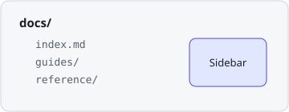

Pages are standard Markdown with GitHub style tables and task lists, plus a few extras described below.

## Frontmatter

Put settings at the top of a file between `---` lines:

```yaml
---
title: Writing pages
description: One sentence shown under the title and in search results.
order: 1
hidden: false
---
```

If you leave out `title`, Docubase uses the first `# Heading`, then the file name. See [Frontmatter reference](../reference/frontmatter.md) for every field.

## Code

Fenced code blocks are highlighted when you name the language, and every block gets a copy button.

```ts
export function greet(name: string): string {
  return `Hello, ${name}`;
}
```

## Callouts

Use `note`, `tip`, `warning` or `danger`. A label in square brackets replaces the default title.

```markdown
:::warning[Before you deploy]
Check that your base path matches where the site is hosted.
:::
```

:::note
This is a note with the default title.
:::

:::warning[Before you deploy]
Check that your base path matches where the site is hosted.
:::

## Tabs

Tabs group alternatives such as package managers. The outer block needs one more colon than the inner ones.

```markdown
::::tabs
:::tab[npm]
npm install docubase
:::
:::tab[pnpm]
pnpm add docubase
:::
::::
```

::::tabs
:::tab[npm]
```bash
npm install docubase
```
:::
:::tab[pnpm]
```bash
pnpm add docubase
```
:::
::::

## Links and images

Link to other pages with a relative path to the Markdown file. Docubase turns it into the right address and warns you if the target or heading does not exist.

```markdown
See [Getting started](../getting-started.md#build-for-production).
```

Images next to your pages are copied to the site. The path is relative to the page.



## Not supported yet

Raw HTML and JSX are removed from pages and reported as warnings, so a page can never run scripts. Components are planned together with the Nuxt theme.
