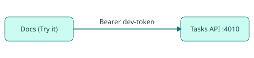

Use this page to eyeball the theme in light and dark mode and on a phone.

## Callouts

:::note
A note with the default title.
:::

:::tip
A tip with the default title.
:::

:::warning[Custom title]
A warning whose title comes from the square brackets.
:::

:::danger
A danger callout with a [link inside](../getting-started.md) and `inline code`.
:::

## Tabs

::::tabs
:::tab[JavaScript]
```js
const res = await fetch('http://127.0.0.1:4010/tasks', {
  headers: { Authorization: 'Bearer dev-token' },
});
console.log(await res.json());
```
:::
:::tab[curl]
```bash
curl -H "Authorization: Bearer dev-token" http://127.0.0.1:4010/tasks
```
:::
:::tab[Python]
```python
import requests
print(requests.get("http://127.0.0.1:4010/tasks", headers={"Authorization": "Bearer dev-token"}).json())
```
:::
::::

## Code highlighting

```ts
type Task = { id: string; title: string; done: boolean; createdAt: string };

export function openTasks(tasks: Task[]): Task[] {
  return tasks.filter((task) => !task.done);
}
```

```json
{ "title": "Buy milk", "done": false }
```

```yaml
title: Buy milk
done: false
```

## Tables

| Status | Meaning | Returned by |
| --- | --- | --- |
| 200 | OK | `GET`, `PATCH` |
| 201 | Created | `POST /tasks` |
| 204 | Deleted, no body | `DELETE /tasks/{id}` |
| 401 | Missing or wrong token | every route except `/health` |
| 404 | No task with that id | routes with `{id}` |

## Task lists

- [x] Done item
- [ ] Open item
- [ ] Another open item

## Images



## Headings and anchors

Every heading gets an anchor. Hover a heading to see it, or link to one like [this](#tables).

### A third level heading

Shown in the contents list on the right.

#### A fourth level heading

Not shown in the contents list.

## Long content

A long paragraph to check line length and the table of contents while scrolling. Lorem ipsum is not used here on purpose: this sentence just repeats an idea so the page is tall enough. The quick brown fox jumps over the lazy dog, again and again, so you can scroll and watch the contents list follow along.
